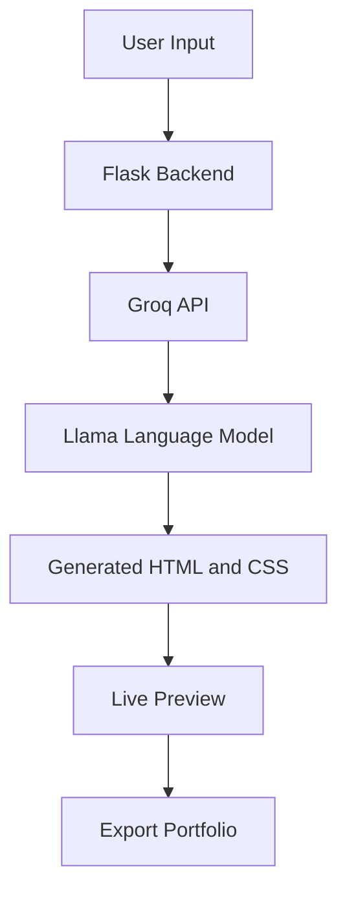

# 🚀 AI Portfolio Generator
### AI-Powered Personal Portfolio Builder


---

## ✨ Overview

**AI Portfolio Generator** is a web application designed to help developers create personalized portfolio websites using AI.

By combining a Flask backend with Groq-powered language model inference, the application takes professional information from the user and generates portfolio content and frontend code.

The goal is to simplify the process of building a personal portfolio without requiring users to design every section manually.

## 🌌 Features

### ⚡ AI Portfolio Generation

- Generate portfolio content from user-provided information.
- Use Groq API for language model inference.
- Organize information into structured portfolio sections.
- Generate HTML and CSS output.

### 🎨 Dynamic Theme Customization

- Customize accent colors.
- Use CSS variables for theme configuration.
- Apply consistent styling across portfolio sections.

Example:

```css
:root {
    --accent: #00ff88;
}
```

### 👁️ Live Preview

- Preview generated portfolio output.
- Display the result inside an iframe.
- Update the preview without manually creating a separate page.

### 💾 Export Options

- Download generated portfolio HTML.
- Copy generated source code.
- Use the exported file as a starting point for further customization.

### 🌍 Arabic and English Support

- Support for Arabic and English content.
- RTL and LTR layout considerations.
- Language-aware generation prompts.

Actual language quality and layout support depend on the implementation and model output.

### 🌙 Modern User Interface

- Dark visual theme
- Glassmorphism-inspired elements
- Smooth hover effects
- Responsive layouts
- Modern typography

## 🧠 AI Generation Pipeline



## 🛠️ Technology Stack

| Layer | Technology | Purpose |
|---|---|---|
| Backend | Python | Application logic |
| Web Framework | Flask | Backend and routing |
| AI Inference | Groq Cloud | Model API access |
| Language Model | Llama 3.3 | Portfolio generation |
| Frontend | HTML5 | Page structure |
| Styling | CSS3 | Visual design |
| Interactivity | JavaScript | Client-side behavior |
| Communication | Fetch API | Frontend/backend requests |

> Confirm the exact model identifier supported by your Groq account and the model configured in your code before publishing a specific model name.

## 📂 Project Structure

```text
portfolio-generator/
│
├── app.py
├── generator.py
├── requirements.txt
├── .env.example
│
├── templates/
│   └── index.html
│
└── static/
    ├── css/
    ├── js/
    └── assets/
```

*This is a simplified example based on the supplied structure. Adjust it to match the actual repository.*

## 🚀 Quick Start

### 1. Clone the Repository

Replace the placeholder with the actual repository URL:

```bash
git clone <YOUR_REPOSITORY_URL>
cd portfolio-generator
```

### 2. Create a Virtual Environment

**Windows:**

```powershell
python -m venv venv
venv\Scripts\activate
```

**macOS / Linux:**

```bash
python3 -m venv venv
source venv/bin/activate
```

### 3. Install Dependencies

```bash
pip install -r requirements.txt
```

### 4. Configure Environment Variables

Create a `.env` file in the project root:

```env
GROQ_API_KEY=your_groq_api_key
```

Replace the example value with your own API key.

Never commit your real `.env` file or API key to GitHub. Keep `.env` in `.gitignore` and provide a safe `.env.example` file instead.

### 5. Run the Application

**Windows PowerShell:**

```powershell
$env:PYTHONIOENCODING="utf-8"
python app.py
```

**macOS / Linux:**

```bash
python app.py
```

## 🌐 Open in Browser

If the Flask application uses the default development port, open:

```text
http://127.0.0.1:5000
```

Check the Flask configuration if your application uses a different host or port.

## 🦾 Prompt Engineering

The generation process can use structured prompts to guide the model toward producing consistent portfolio layouts.

Potential generation constraints include:

- Semantic HTML structure
- Responsive layouts
- Consistent CSS styling
- Organized portfolio sections
- Clean output without Markdown wrappers
- Compatibility with the preview interface

The exact constraints depend on the prompts and validation logic implemented in the project.

## 🔥 Example Portfolio Sections

Generated portfolios may include:

- Hero section
- About Me
- Skills
- Work Experience
- Projects
- Education
- Contact Information
- Social Links
- Footer

## 🛡️ Security Considerations

- Store API keys in environment variables.
- Never expose secret keys in frontend JavaScript.
- Validate and sanitize user-provided information.
- Treat AI-generated HTML and JavaScript as untrusted content.
- Use an appropriately restricted iframe sandbox for previews.
- Avoid executing generated scripts with unnecessary privileges.

An iframe alone does not guarantee that generated content is safe; review its sandbox permissions and the way generated content is rendered.

## 📈 Future Roadmap

- [ ] Multi-page portfolio generation
- [ ] Resume PDF export
- [ ] Additional design themes
- [ ] Portfolio hosting integration
- [ ] AI-generated image support
- [ ] GitHub profile integration
- [ ] Drag-and-drop editing
- [ ] Portfolio editing before export

## 🤝 Contributing

Contributions, suggestions, and improvements are welcome.

```text
Fork → Clone → Create Branch → Commit → Push → Pull Request
```

## 👨‍💻 Developer

**Ahmad Nazzal**

[GitHub Profile](https://github.com/ahmadnazzal22)

Built with Python, Flask, and AI-powered content generation.

## 📜 License

Specify the license that is actually included in the repository. If using MIT, add a `LICENSE` file containing the MIT License text.

---

### ⚡ Generate. Preview. Customize. Export.

**Building better personal portfolios with AI.**
